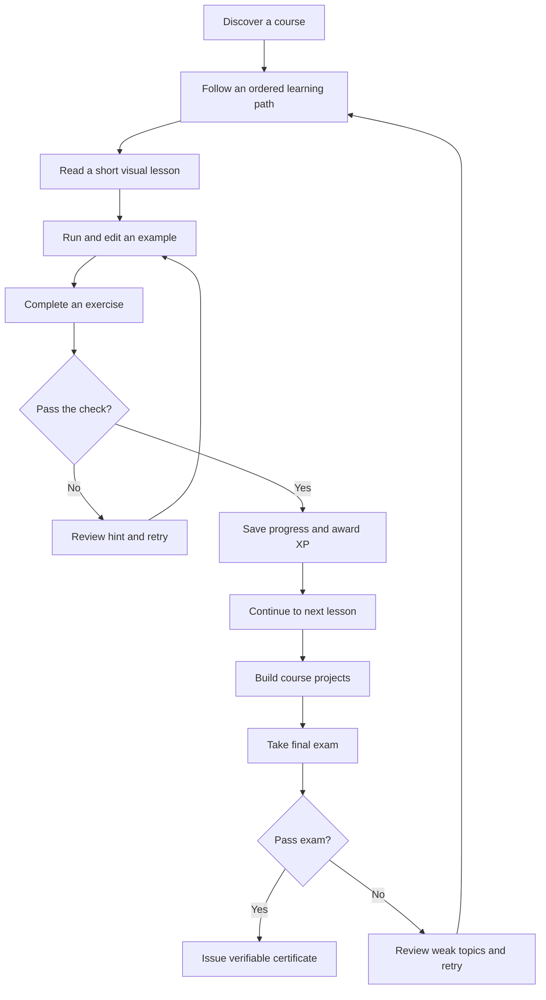
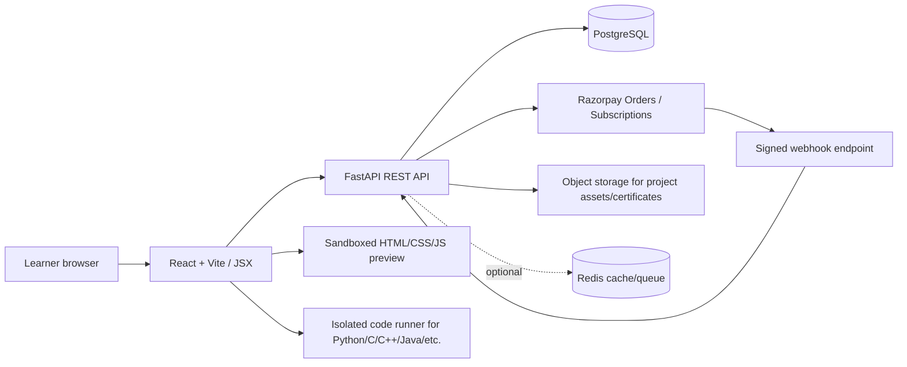
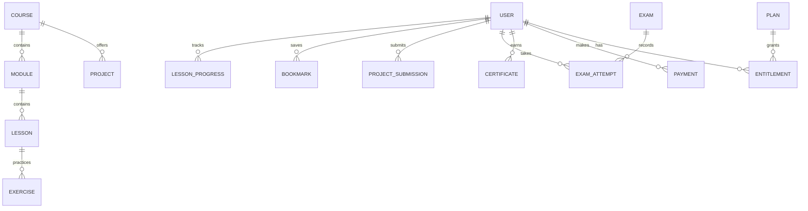
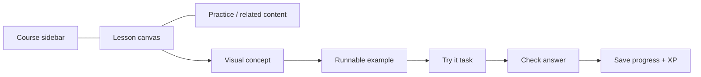

# CodeLeaf — Product Blueprint and Base Logic

> Working name only. Replace **CodeLeaf** with the final brand before launch. This blueprint uses W3Schools as a functional reference, not as a visual or content template to copy.

## 1. Product vision

CodeLeaf is a visual-first learning platform where a learner can move from a lesson to runnable examples, exercises, projects, a skills assessment, and an earned certificate without leaving the platform. The base is deliberately modular: launch the learning shell first, then add course content by reusing the Master Course Prompt in `MASTER_COURSE_PROMPT.md`.

### Primary learner loop

## 2. What the screenshots imply

| Screenshot pattern | Feature to implement | Base behavior |
|---|---|---|
| Two horizontal navigation bars | Global header + topic strip | Search, tutorials, references, exercises, certificates, projects/playground, plans, profile |
| Tall collapsible tutorial sidebar | Course outline | Grouped modules; current lesson highlighted; exercise/challenge rows; mobile drawer |
| Centered lesson content with Prev/Next | Lesson reader | Outcomes, visual explanation, code editor/demo, task, recap, previous/next, bookmark, mark complete |
| Right rail and bottom banners | Limited ad inventory | Reserved slots, responsive hide/collapse, never in payment or exam flows; no ad for Max/Full Access |
| Plan comparison cards | Pricing & checkout | Pro ₹299/month; Max ₹699/month; Full Access ₹49,999 one time |
| Personalized character/profile | Avatar & profile | Editable display name, handle, avatar pieces, theme and profile visibility toggles |
| My Progress page | Learning analytics | XP, completed lessons, exercises, quizzes, challenges, exams, per-course progress |
| League / leaderboard | Gamification | Weekly ranking, Hall of Fame, tiers, opt-in public nickname, server-calculated XP |
| Bookmarks empty state | Saved lessons | Add/remove saved lessons and useful empty state |
| Certificates catalogue | Exams and credentials | Search/filter exams, start attempt, results, certificate issuance after passing |
| Certificates overlay/catalog | Certification discovery | List certificates by language/topic and bundle/course paths |
| Homepage resume card | Continue learning | Persist last lesson and show progress, streak and next recommended action |
| W3Schools footer columns | Site-wide discovery | Tutorials, references, examples, projects, company/help/legal links |

## 3. Functional inventory

### Learning and content
- Catalog of languages, frameworks, databases, developer tools, data/AI topics and career paths.
- Course overview with prerequisites, level, outcomes, estimated effort and syllabus.
- Ordered modules and lessons with stable slugs and lesson IDs.
- Collapsible desktop sidebar, searchable curriculum and mobile slide-out drawer.
- Prev/Next, progress state, bookmarks, last-read position and related lessons.
- Short, visual lessons: diagrams, tables, code examples, output preview, common mistakes and short recap.
- Reference pages for syntax, built-ins, properties, methods, commands and concepts.
- Examples gallery and a safe code playground.
- Guided projects at beginner/intermediate/advanced levels with steps, checkpoints, starter files and rubric.

### Practice and assessment
- Exercises: multiple choice, fill-in-the-blank, order/drag-and-drop, output prediction, debug-the-code, and coding tasks where supported.
- Quizzes after logical groups of lessons.
- Code challenges with problem statement, examples, constraints, hints, solution discussion and test cases.
- Course assessments/final exams with attempts, timing if required, scoring, remediation and configurable pass score.
- Certificate issued only after a verified pass; unique ID/verification URL and downloadable PDF in a later phase.

### Learner profile and motivation
- Email/password account and secure sign-in/session management.
- Profile nickname, avatar builder, selected theme, accessibility preferences and optional public profile.
- Course progress, XP ledger, streaks, achievements, badges, weekly leagues and Hall of Fame.
- Optional XP boost entitlement for Max and Full Access.
- Bookmarks, recently visited lessons and saved projects.

### Monetization
| Plan | Price | Entitlements |
|---|---:|---|
| Free | ₹0 | Browse free learning content; ads; limited or no saved progress depending on account policy |
| Pro | ₹299/month | Track progress, code challenges, assessments, leaderboard competition, cancel anytime |
| Max | ₹699/month | Everything in Pro, ad-free learning, 50% XP boost, priority support, cancel anytime |
| Full Access | ₹49,999 one time | Everything in Pro and Max for the lifetime of the platform, subject to published terms |

Entitlements must be enforced by the backend, not only hidden in the UI. Treat prices and benefits as versioned server-side configuration. Show tax and renewal terms clearly before purchase. Max and Full Access suppress ad slots. The monthly plans use Razorpay Subscriptions; lifetime access uses a Razorpay Order and one-time payment. A gateway setup, merchant onboarding, plan IDs, policy pages, and test transactions are prerequisites to real payments.

### Ads: controlled, respectful inventory
- Optional placements: course catalog card/list slot; lesson right rail on desktop; one bounded in-content slot after a meaningful content block; perhaps a footer slot.
- Never insert ads inside code samples, between a question and its choices, during exam attempt/results, on checkout/payment, login, password reset, or certificate verification pages.
- Do not use pop-under, forced redirects, fake buttons, or ads that cover primary navigation.
- Collapse/remove slots at small widths and respect reduced-motion preferences.
- Do not enable personalised targeting for child/teen learners. Implement consent/privacy controls and comply with applicable ad-provider and local requirements before enabling a network.

### Admin and content operations
- Admin-only course/module/lesson editor, publish/draft/version status and curriculum import.
- Exercise/question bank, exam configuration, certificate templates, plan/entitlement configuration and ad-slot settings.
- Moderation/support tools, reports, payment reconciliation and audit log.
- Content health checks: broken links, missing code output, duplicate slugs, lesson gaps, stale references and accessibility checks.

## 4. Recommended languages, frameworks and tools

| Layer | Choice | Why |
|---|---|---|
| Frontend markup | HTML5 | Semantic page structure and accessible controls |
| Frontend styling | CSS3 | Responsive layouts, tokens, dark/light themes and animation constraints |
| Frontend programming | JavaScript (modern ECMAScript) | Application logic; **no TypeScript in the product source** |
| UI syntax | React JSX | Reusable components and pages; JSX is JavaScript, not TypeScript |
| Frontend build/routing | Vite + React Router | Fast development and explicit routes |
| Icons | Lucide React (or equivalent open icon set) | Consistent scalable icons |
| Backend | Python 3 + FastAPI | Typed API boundaries, validation and OpenAPI docs |
| API schemas | Pydantic | Request/response validation |
| Database language | SQL | Queries, constraints, indexes and PostgreSQL schema |
| Database | PostgreSQL (Neon-hosted PostgreSQL is a suitable option) | Relational content/progress/payment records and transactions |
| ORM + migrations | SQLAlchemy 2 + Alembic | Relational mapping and controlled schema migrations |
| Payment | Razorpay Checkout + Razorpay Orders + Razorpay Subscriptions | One-time Full Access and monthly plans |
| Code editor | Monaco Editor or CodeMirror | Editor experience with syntax support |
| Web output sandbox | Sandboxed iframe | Render user-created HTML/CSS/JS without giving it same-origin access to the platform |
| Non-web code runner | Dedicated isolated execution service (e.g. Judge0/Piston or a controlled worker) | Never execute learner code inside the FastAPI process or main database worker |
| File/assets | Object storage (e.g. S3-compatible service) | Project files, avatars and certificate PDFs |
| Optional cache/jobs | Redis + a task worker | Add only when needed for rankings, rate limits and asynchronous jobs |
| Testing | Pytest, Vitest/React Testing Library, Playwright | Backend, component and end-to-end coverage |
| Version control | Git + GitHub | Changes, issues and deployment workflow |
| Deployment | Vercel frontend; Render or equivalent Python backend; managed PostgreSQL | Clear separation of deployable services |

### Language rule
The learning platform's own source code uses JavaScript/JSX, CSS and Python, with SQL for PostgreSQL. The educational catalog can still contain tutorials for TypeScript or other languages; those are *lesson topics*, not permission to author the website itself in TypeScript.

## 5. Architecture

### Key boundary decisions
1. Backend is authoritative for plan entitlement, payment status, XP, exam score and certificate validity.
2. A successful Checkout callback is not, by itself, enough to grant access. Verify the signature on the server, reconcile the payment status and process signed webhooks idempotently.
3. Never accept the amount, plan benefit, XP award, exam result or certificate status from the browser as authoritative.
4. Never run arbitrary submitted code as a subprocess in the web API process. Use an isolated runner with CPU/time/memory/network limits, and initially limit the playground to sandboxed browser examples.
5. Use migrations for production database changes; do not casually delete migration history or rely on automatic schema creation at startup.

## 6. Base data model

### Main entities
- `users`: id, email, password hash, nickname, public handle, avatar JSON, role, created_at, disabled_at.
- `courses`: id, slug, title, short description, category, level, language/tool, status, version.
- `modules`: id, course_id, stable slug, title, sequence, core/optional flag.
- `lessons`: id, module_id, stable slug, title, sequence, content JSON/Markdown, estimated minutes, publish status.
- `examples`: lesson_id, title, code language, source files, expected output, run mode.
- `exercises`: lesson_id, type, prompt, choices/starter code, hidden tests, public test cases, answer/explanation and XP value.
- `lesson_progress`: user_id, lesson_id, status, time spent, completed_at, last_position.
- `bookmarks`: unique user_id + lesson_id.
- `projects` / `project_submissions`: steps, assets, files, submission snapshot, rubric scores and status.
- `exams` / `exam_attempts`: question bank refs, randomization seed, started/submitted timestamps, score, pass status, attempt number.
- `certificates`: user_id, exam_id, unique public verification code, issued_at, revoked_at, metadata snapshot.
- `plans`, `payments`, `subscriptions`, `entitlements`, `webhook_events`: server-priced plan, gateway IDs, status, signature verification result, idempotency key, billing dates and access grants.
- `xp_ledger`, `achievements`, `league_snapshots`, `avatar_items`: auditable XP changes, rewards and weekly rankings.
- `ad_slots`, `content_versions`, `audit_logs`: configuration and admin traceability.

Store money as integer paise; avoid floating point for currency. Keep the provider's IDs, status, amount, currency and timestamps for reconciliation. Never store card details.

## 7. Plan access matrix

| Feature | Free | Pro | Max | Full Access |
|---|:---:|:---:|:---:|:---:|
| Public tutorials and references | Yes | Yes | Yes | Yes |
| Saved progress | Basic/defined by policy | Yes | Yes | Yes |
| Code challenges | Limited/free sample | Yes | Yes | Yes |
| Assessments | Sample/free content | Yes | Yes | Yes |
| League/leaderboard | Public preview | Yes | Yes | Yes |
| Ads | Yes | Yes | No | No |
| XP multiplier | 1× | 1× | 1.5× | 1.5× |
| Priority support | No | No | Yes | Yes |
| Lifetime entitlement | No | No | No | Yes |

`Full Access` is a one-time lifetime entitlement, not a recurring plan. Publish a clear lifetime-access definition, exclusions, refund policy and business-continuity terms before selling it.

## 8. Main pages and routes

| Route | Purpose |
|---|---|
| `/` | Home: resume learning, course cards, stats, projects and practice |
| `/tutorials` | Browse/search/filter course catalog |
| `/learn/:courseSlug/:lessonSlug?` | Course lesson reader with outline and Prev/Next |
| `/reference/:courseSlug` | Reference guide |
| `/examples/:courseSlug` | Code examples and demos |
| `/exercises/:courseSlug` | Lesson/course exercises |
| `/challenges` | Coding challenges |
| `/projects` | Guided projects and project gallery |
| `/playground` | Code editor and safe preview |
| `/dashboard` | Learner overview and shortcuts |
| `/progress` | Progress and activity metrics |
| `/leaderboard` | Weekly league and Hall of Fame |
| `/bookmarks` | Saved learning resources |
| `/certificates` | Certification catalog and earned certificates |
| `/exam/:examSlug` | Exam attempt and result |
| `/profile` | Avatar, nickname, preferences, public profile settings |
| `/plans` | Pricing and plan comparison |
| `/settings` | Privacy, account and notification settings |
| `/admin/*` | Protected content, assessment, users, payments and ad administration |

## 9. Lesson layout template

A published lesson should have, in this order where suitable:
1. Title + one-sentence explanation.
2. Prerequisites and 2–4 learning outcomes.
3. One clear visual explanation (diagram, comparison table, timeline, state diagram or annotated illustration).
4. Short explanation in plain language.
5. Minimal working example plus “Run”, “Reset”, “Copy”, and expected output.
6. A practical task with hint(s), validation rules and solution explanation available after an attempt.
7. Common mistakes / what changes if a line is removed.
8. Quick-check quiz or recap, references, previous/next and bookmark controls.

Keep visuals educational: use diagrams and tables when they encode a relationship; do not add decorative images just to increase image count. Use alt text, captions, keyboard-accessible controls and responsive sizing.

## 10. Responsive layout rules

- Desktop: global header, secondary course strip, lesson left rail (approx. 250–280 px), flexible content center, optional narrow right rail.
- Tablet: collapse or narrow left rail, remove the right rail, keep code editor/result panes resizable or vertically stacked.
- Mobile: single-column content, drawer-based course navigation, sticky compact header, large tap targets, horizontal tab strips, vertically stacked editor/output, no horizontal page overflow.
- Ads must not push lesson navigation off screen or obscure code/results. At small widths, hide or collapse optional ad slots.
- Respect `prefers-reduced-motion`, visible keyboard focus, semantic headings and zoom. Do not disable browser zoom.

## 11. Security, privacy and reliability checklist

- Passwords are salted and hashed with Python’s `hashlib.scrypt`; keep the algorithm parameters versioned and reviewed.
- Use secure, HttpOnly, SameSite cookies or a reviewed token/session architecture; add CSRF protection when cookie-authenticated state changes require it.
- Validate inputs server-side; use parameterized ORM queries, output escaping and a restrictive Content Security Policy where practical.
- Keep secrets only in server environment variables; never commit `.env` or expose Razorpay secret/webhook secret in Vite variables.
- Verify Razorpay checkout signatures and webhook HMAC against the raw request body; use unique webhook event IDs to avoid double-processing.
- Add rate limits to login, exam start/submission, payment creation and code execution.
- Avoid collecting unnecessary personal data. Use consent controls and data deletion/export workflows appropriate to applicable law.
- For public leaderboards, show nickname/avatar only with appropriate user controls.
- Code runner: isolated container/worker, no privileged mode, read-only base filesystem, strict execution quotas, bounded output and network disabled by default.
- Back up PostgreSQL and test restoration. Use Alembic migrations and staging before production.

## 12. Build roadmap

| Phase | Deliverable | Gate before moving on |
|---|---|---|
| 0. Foundation | Branding, tokens, routing, responsive shell, design system | Desktop/tablet/mobile navigation passes |
| 1. Base platform | Home, tutorial sidebar, lesson reader, plans/profile/dashboard route shells | Real navigation and empty/error states work |
| 2. Backend base | FastAPI, PostgreSQL schema, migrations, catalog/progress/bookmarks endpoints | API tests and migration smoke test pass |
| 3. First course | HTML curriculum import and several complete lessons | Content QA, link checks and editor sandbox test pass |
| 4. Practice | Exercises, quizzes, challenge model and XP ledger | Server-side scoring and retries tested |
| 5. Accounts & avatar | Auth, profile/preferences, avatar inventory | Permission and session tests pass |
| 6. Payments | Razorpay monthly subscriptions + lifetime order, webhooks and entitlements | Test mode end-to-end, signature/idempotency tests, refund/renewal paths reviewed |
| 7. Exams | Question bank, exam attempts, certificates and verification | Pass/fail, retake, revoke and verification tests pass |
| 8. Projects & IDE | Save projects, file tree and sandboxed web preview; isolated runner later | Resource-limit and isolation tests pass |
| 9. Monetization/admin | Ad slots, frequency caps, CMS and admin audit tools | Ads removed for Max/Full Access and excluded from critical flows |
| 10. Production hardening | Accessibility, security, performance, backup and observability | Release checklist completed |

## 13. Source analysis vs project decisions

- **From the provided `HTML(1).pdf`:** its stated syllabus is 26 modules and 141 lesson topics, progressing from introductory concepts through accessibility, performance, security, testing and professional practices. It recommends each exercise have a task, starter instructions, expected outcome and checklist/automated validation; it has beginner-to-advanced exercises and realistic projects; it keeps specialized content optional; it calls for current-specification checks and avoids duplication. See the PDF's Sections A–G and final quality-control notes.
- **From the supplied screenshots:** the required interface patterns are the two-level header, course sidebar, lesson Prev/Next, bookmark, profile/avatar, progress, leaderboard, bookmarks, certificates/exams, subscription cards, discovery modal, footer, and measured ad placements.
- **From live reference research:** W3Schools currently publicly presents tutorials, references, examples, exercises, quizzes, code challenges, browser editors, website-building/hosting, progress tracking and certificate discovery. Its current plan page is not your planned INR pricing, so the prices in this spec are your requested prices, not copied reference prices. [Homepage](https://www.w3schools.com/) · [Tutorials](https://www.w3schools.com/tutorials/) · [Exercises](https://www.w3schools.com/exercises/) · [Tryit](https://www.w3schools.com/tryit/) · [Plans](https://order.w3schools.com/plans)
- **Project decisions/inference:** CodeLeaf name, palette, route map, data model, plan enforcement, architecture, ad rules, and implementation phases are recommendations for your new product, not claims about W3Schools' internal implementation.

## 14. Acceptance criteria for the base

- All primary routes render and can be reached with working navigation.
- The UI has usable desktop, tablet and phone layouts; no content requiring hover only.
- Lesson sidebar is searchable/collapsible and has the current lesson state.
- Prev/Next, mark complete, bookmarks, profile controls and exam demo provide visible feedback.
- Pricing cards show exactly ₹299/month, ₹699/month and ₹49,999 lifetime with the listed entitlements.
- Free/paid/ad visibility is controlled by one entitlement rule set.
- API documents setup steps, env vars and unfinished integrations honestly.
- No TypeScript files are used for platform source.
- No live payment, persistence or isolated multi-language execution is claimed until its env/setup and tests are complete.
